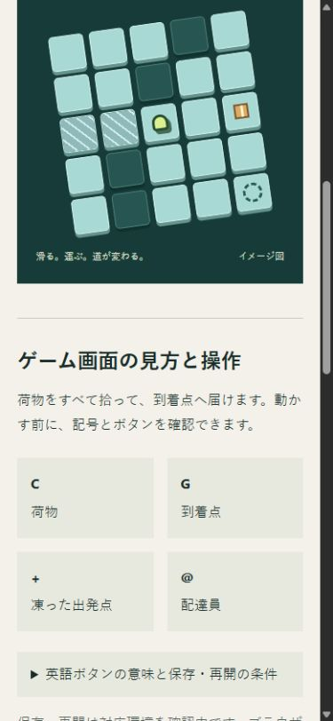
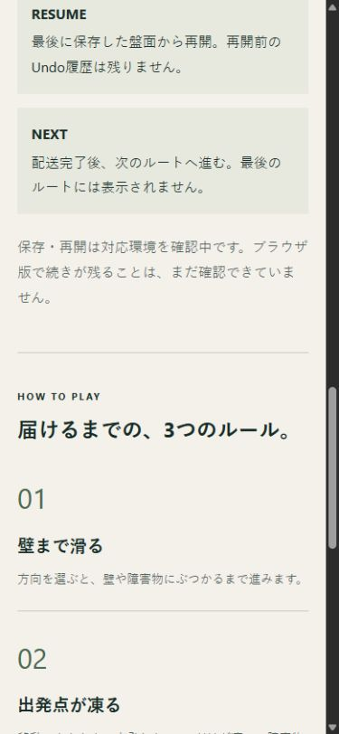

# 初回案内の改善と19時の戦略判断

2026-10-11の19時枠。Web全体刷新の指示を優先し、既存T-ice-courier-touch-polishのF1〜F3のうち、配布ビルドに依存しないWeb説明を改善した。元の工程と[受入条件](2026-10-11-first-play-and-save-acceptance.md)を保持する。技術上の判断はimprove、事業判断はunobserved。

## 確認した事実と今回の改善

GitHubのunity-ci.ymlを読み取り照会した。最新の成功runは37949250206、sourceCommitは6b673b86155271de12c22c5f0460ece2b2c2f2fd、作成日は2026-10-09。2026-10-11のresponsive-v1実装に対応する新成果物は今回の一覧にない。外部操作の再送は行わず、独立した説明整備を進めた。

| 証拠 | 結果 | 判断と対応 |
| --- | --- | --- |
| 現行CourierBoard.csをPowerShellのAdd-Typeで実行 | 初期は(1,1)、右1手で(5,1)、荷物1、凍結は(1,1)だけ。Undoで初期状態へ戻った | 出発した1マスだけが凍ると、作品カード・詳細見出し・ルール・メタ説明へ明記 |
| 同じソースのRestoreと、その後の移動・Undo | Restore直後のUndoはfalse。その後の下移動は配送完了、新しいUndoで再開盤面へ戻った | RESUMEは最後に保存した盤面から再開し、再開前のUndo履歴は残らないと案内 |
| ゲーム内ラベルとWebの照合 | C/G/+/@、方向ボタン、UNDO/RESTART/RESUME/NEXTは英語表示 | 記号の意味を常時表示し、長いボタン説明は展開できる案内にした。色だけに頼らず選べるようにした |
| 新Web保存の検証範囲 | Editorの既存検査はあるが、新Web版の保存往復は未確認 | 条件のない保存保証を削除。対応環境を確認中と明記し、Restartの保存上書きも案内 |
| Chromiumの390×844と1280×720 | 案内幅335/1152px、本文・ラベル16px、横はみ出しなし。標準版のiframeと開始ボタンは0 | Web案内の表示は確認済み。新Unityキャンバスの操作寸法へ読み替えない |
| 検索と画面遷移 | 「凍る」で1件、公開中は0件、全件復帰と詳細→/#works→詳細が成功 | 制作中と公開中の区別、カードの変更後の検索と導線を維持 |
| 操作案内の折り畳み | 390pxで閉じた状態と開いた状態の横はみ出しなし。Enterで開閉。操作対象幅335px・高さ52.80px、本文16px | 初期画面で読む量を抑え、ボタン説明が必要なときに開く。未確認のWeb保存の注記は常時表示 |

Add-Typeの検査は変更していない盤面クラスの.NET実行であり、Unity Editor、Web PlayerPrefs、実タッチの検査ではない。前回のUnity EditMode/PlayMode・Editor結果は保全し、今回再実行した結果とは扱わない。

今回の画像はローカル標準プレビューのWeb画面のみ。ゲームの実盤面ではなく、5×5の図は引き続き「イメージ図」と表示する。周辺デスクトップを含む07時の生画像は使用していない。

## 次の一工程

同じT-ice-courier-touch-polishで、同一ソースのresponsive-v1 Actions Windows/Web成果物を照合してローカルWebへ接続する。新しい枠で最終CSS寸法・フォーカス・終了・失敗・再試行・保存再読み込みを検査する。成果物が保留の間は、同じタスクのF3「保存不可の案内が配送完了で消えない」を独立して再現・修正する。現行MoveのSave後に完了noticeが上書きされる順序はソースで確認したが、例外を発生させた実画面での再現は未実行。対応環境の確認とゲーム内の修正を完了扱いにしない。

実端末タッチ、Safari、人間の無補助初回プレイは別検査として残す。初回理解の改善と需要の増加は、まだ証明されていない。今回のブラウザ実測は人間の反応ではなく技術検査。元の[縦画面受入条件](2026-10-10-portrait-entry-acceptance.md)も維持する。

## 観測と保全

月間純利益・訪問・開始率・完了率・再訪はnull。E-unity-portalのreleaseはnullで、14/28日観測は未開始。売上や作品数を成功指標にせず、公開・実測の条件が揃ってから観測する。

WebビルドのTypeScript・ESLint・Viteと5ページ静的生成、旧4URL・Unity GUID19件、36成果物チェックサムとローカルUnity成果物の混入防止を検査した。最新checkpoint2ハッシュ、親4HEAD・復元8ハッシュを照合した。天啓.mdの全体刷新は未完了のため保持する。旧クラウド台帳、親4原本・復元保管庫、Atohitoriには変更を加えない。Unityソースは不変。外部push・PR・merge・配信・投稿・有料契約なし。

最初の検査用サーバーはWeb設定の指定が抜けており、親の旧distが表示されたため検査に採用しなかった。自分が起動したプロセスだけを終了し、web/vite.config.tsを明示したサーバーで上記の検査を行った。既存4178プレビューは操作していない。照会の最初のworkflow名も404だったため、実在するunity-ci.ymlへ訂正した。いずれも公開や元ファイルの変更は発生していない。
