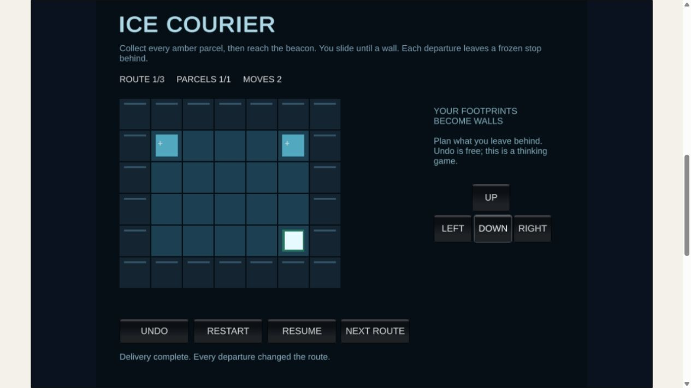
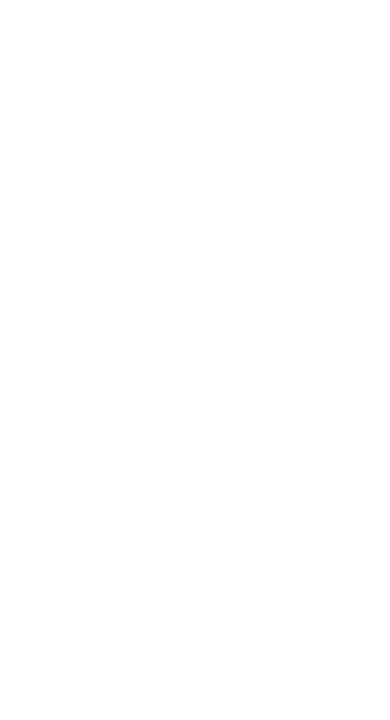

# Ice CourierのローカルWeb接続

2026-10-10 07時枠。T-unity-portal-player-integration。天啓.mdのWeb刷新を継続した。

作品詳細に開始、読み込み中、操作可能、失敗、再試行、終了と一覧への戻り先を実装した。Unity起動完了を同一originかつ該当iframeから受け取る。Tabは終了ボタンへ戻り、終了時はiframeを破棄して開始ボタンへフォーカスを戻す。画面内遷移で一覧へ戻る場合もUnityを解放する。

接続先はGitHub Actions run 37945379221のローカルWebGL成果物。sourceCommitはe393bd321dbca383f0fcb31f20219a27df5df6f2。SHA256SUMSの18ファイルとbuild-version.jsonを照合した。現在のunity/IceCourierにはそのcommitから差分がない。成果物の元バイト列を変更せず、別のrunner HTMLで読み込む。照合したバイト列を起動時に保持し、配信中のファイル変更で版が混ざらないようにした。

## 検査

| 検査 | 結果 |
| --- | --- |
| TypeScript・ESLint・静的5ページ生成 | 成功 |
| 旧4URL・Unity GUID・生成リンク・Web SHA256 | 成功 |
| WebGL版・18ファイルSHA256・Unityソース差分 | 一致・差分なし |
| 開始からUnity操作可能への状態遷移 | 実ブラウザで成功 |
| 方向キー・荷物回収・配送完了・ZによるUndo | 実画面で成功 |
| 終了・再起動・Resume・Down画面ボタン | 荷物1/1、手数1を復元後、2手で完了 |
| Tabで終了ボタン・Enter終了・開始へフォーカス復帰 | 成功、終了後iframe 0 |
| ローダー遮断と解除後の再試行 | 失敗案内を表示、解除後に操作可能へ復帰 |
| 一覧へ戻る | /#worksへ移動、worksへフォーカス、iframe 0 |
| 1280×720・390×844 | プレイヤー枠を確認、横のはみ出しなし |
| 通常の公開用ビルド | 静的ページに開始ボタン・iframeなし。Unity成果物を含めない |
| Unity再コンパイル・EditMode・PlayMode・新Windows/Webビルド | 今回未実行。ゲーム本体は変更していない |
| 実タッチ・人間の反応・事業指標 | 未観測 |

390×844の検査はデスクトップブラウザのviewport変更。実端末のタッチ検査ではない。Unity内部の文字とボタンは縮小されるため、小ささを既存のT-ice-courier-touch-polishへ残す。画像は実画面の記録で生成素材ではない。

## ローカルでの確認

先にnpm run buildを実行する。PowerShellで$env:KIHAMDA_LOCAL_PLAYER='1'を設定し、web/でnode node_modules/vite/bin/vite.js preview --host 127.0.0.1 --port 4178 --strictPortを起動する。ローカル成果物がない環境ではこのフラグを設定しない。通常のビルドとプレビューはフラグ不要。

専用middlewareは接続元をloopbackに限定し、チェックサムに載ったファイルだけ配信する。Unityのwasm・dataやrunnerをdistへコピーしない。公開状態はnull、公開開始リンクは出さない。配布・mainへのmerge・サイト全体置換は未実行。

次の一工程は既存のT-ice-courier-touch-polishでUnity内部の縦画面レイアウトを改善すること。Web刷新全体は未完了で、天啓.mdは残す。外部pushの前回の承認待ちは変化がないため再送・反復通知しない。
