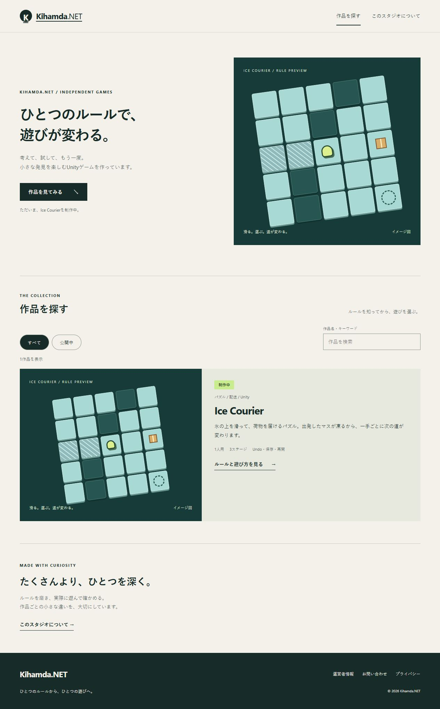
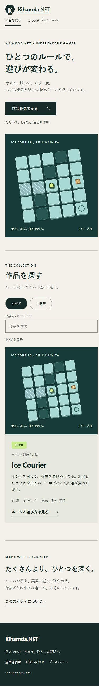

# Unity作品のWeb入口の刷新

2026-10-10 01時枠。本人の天啓.mdを優先し、Ice Courierを唯一の制作中作品として継続した。新作・サブエージェント・本番配信は実施していない。

トップの「新着・おすすめ・全作品」の重複を一つの一覧へまとめ、検索、公開状態の絞り込み、空結果の解除、詳細画面のルール説明を追加した。根拠のない12,450+の累計プレイと廃止作品への構造化データを除いた。運営者情報・問い合わせ・プライバシーにも同じヘッダーとフッターを使う。プライバシーの方針本文と問い合わせ先、返信目安は保持した。

共通画面から5ページを静的生成し、JavaScriptなしでも本文とページ間リンクを出す。検索と絞り込みはJavaScriptが必要。ページ名・説明・canonicalは静的HTMLと画面内遷移で同じ定義を使う。旧4作品のカタログとURLは復元・保全のため残し、新しいUnityカタログと分けた。今後の作品登録はUnityカタログ、ページ定義、詳細内容と作品登録の整合を検査する。

## 検査

| 検査 | 結果 |
| --- | --- |
| TypeScript・ESLint・Vite・静的5ページ生成 | 成功 |
| 旧4作品のURLとUnity GUIDの契約 | 成功 |
| 生成HTMLのローカルリンク・JS・メタデータ・SHA-256 | 成功 |
| 検索「配送」、一致なし、リセット、公開中0件 | 実ブラウザで成功 |
| Enterによる絞り込みと詳細への移動 | 実ブラウザで成功 |
| 詳細から一覧、問い合わせ、プライバシー、運営者情報 | 実ブラウザで成功 |
| 直接再読み込みとページタイトル更新 | 成功 |
| デスクトップ・390×844 | 表示確認。縦画面5ページで横のはみ出しなし |
| 台帳テスト | 24件成功。許可済みartifacts/test-temp使用 |
| 親4リポジトリの元commitと復元ハッシュ | 一致 |
| Unityコンパイル・EditMode・PlayMode・新配布ビルド | 今回未実行。前工程の結果と混同しない |
| 実タッチ・面白さ・訪問・開始率・完了率・再訪・利益 | 未観測 |

盤面はCSSで手作業した説明図で、Unity実画面のスクリーンショットではない。外部素材とAI生成画像は使っていない。

## 次の一工程

検証済みGitHub Actions成果物をローカルの作品詳細画面へ接続し、読み込み・開始・終了して戻る・失敗時の案内を確認する。ソースと成果物の版を照合する。未配信の段階では公開中と表示しない。スマートフォンでのUnity実画面と実タッチは未完了の既存工程を継続する。全面刷新と本番全体置換は同じ意味として扱わず、今回のPRは内部レビュー用とする。天啓.mdのWeb刷新指示は完了扱いにしていない。
