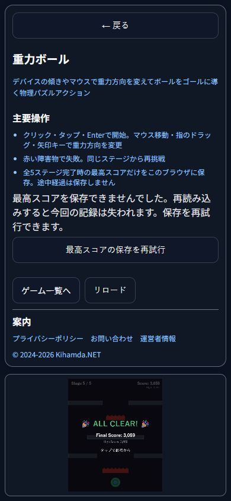
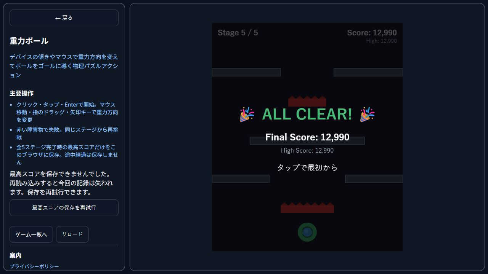

# GravityBallの最高スコア保存再試行

2026-10-15の07時枠の継続工程。n目並べの工程をcheckpoint195/complete196で完了した後、T-web-gravity-score-retryを追加し、同じ07時slotの継続runとして開始した。予定枠は取得し直していない。WIPは常に1、全体の保存期限は07:25を維持した。

旧useHighScoreをそのまま実行すると、保存値20から100へ更新した書き込みが拒否され、API復旧後に100を渡してもupdate=false、保存値20、警告trueのままだった。画面内最高値を先に更新したことで、同点を新記録として扱わない条件に入り、保存を再試行しなかった。

未保存操作を保持し、同点以下の有効な結果でも現在の最高値を再保存する。新記録判定はfalseのままなので、新記録演出を重ねない。最高値を下げることもない。専用の再試行ボタンから、再プレイをせずに保存できる。失敗時は警告を保ち、成功時は解除してゲームへフォーカスを戻す。resetの失敗は削除として再試行する。

実hookで拒否継続、同点再試行、明示再試行、最高値保持、削除再試行を検査。既存の5ステージ幾何ルート、入力、得点重複、遷移・再開・unmount検査も成功。型・ESLint・Vite・5画面・35ハッシュ、作品案内・導線、4作品の回帰、台帳27テストが成功した。

専用Chromeの127.0.0.1:4216で最高スコアキーだけを書き込み拒否にした。保存を発生させるためReactのゲーム状態に最終ステージのゴール・初期スコア・速度0を注入した。これは保存経路のfixtureで、通常プレイの完走や利用者の記録ではない。拒否中の再試行クリック後も警告を保持。API復旧後、1280のEnter、390のクリックで保存が成功し、警告と再試行ボタンが消え、ゲームへフォーカスが戻った。再読み込み後の保存値3059/6964も読み取り確認した。最後の再試行後の12990は保存APIで読み取った値で、その後の再読み込みは未実行。全数値はfixture由来で成果指標へ使わない。

ボタンは390で348×44px、1280で286×44px、文字14px。横はみ出しなし。1280の最初の画像は390から変更直後でcanvas159×190.8pxの過渡配置だったため、安定後のcanvas500×600pxで撮り直した。390の警告時canvasは159×190.8pxであり、枠内配置のみ確認した。警告中の盤面の読みやすさはこの工程で改善済みとは扱わない。

Storage APIを復元しviewport解除・専用タブ終了を確認。既存Unity、天啓、旧クラウド台帳、親4原本/復元、以前のCIパッケージは保持。本日PR23はマージ済みのため追加PR・push・配信なし。記事は下書きのみ。現在の追加実装にはリモートCI承認なし。実タッチ・Safari・センサー・人間評価は未確認、利益等の指標はnull。

次の一工程は最高スコアの読み込み状態の案内。現行hookは読込拒否と不正数値を0として通知しない。新工程では実コードの再現から始め、保存再試行と区別して扱う。

