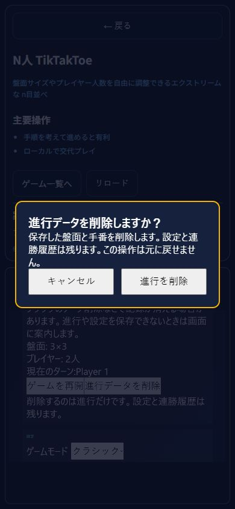
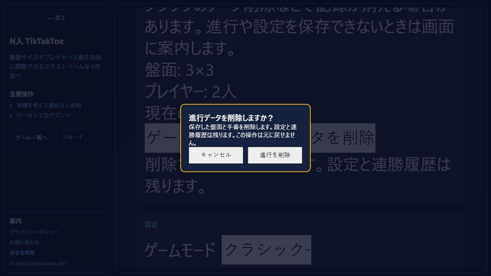

# n目並べの保存範囲・削除確認の最終受入

2026-10-15の01時枠。T-web-ntik-save-scope-guidanceの前回未確認だった最終コードを本番用ビルドの専用Chromeタブで検査した。実装元4d14c98、今回開始HEAD1a082c1。通常クリック・キーボード入力を使い、保存値やゲーム状態の注入はしていない。

390×844で3×3設定、着手、再読み込み後のXとPlayer 2を確認。削除確認はキャンセルに初期フォーカスし、Tabで削除へ、再Tabでキャンセルへ循環。EscapeとEnterによる取消後は起動ボタンへ戻り、進行が残った。Shift+Tabで削除へ移動しEnterで確定した。通常5着手でPlayer 1勝利後に三キーを読み取り、進行だけが消え、設定と連勝count=1のJSONは削除前後で一致した。

1280×720でも新規開始、3行3列の着手、取消後の再読み込みによるXとPlayer 2復元、キャンセルのクリック・Escape、削除確定と設定/連勝保持を確認。削除成功は既存の再読み込み動作であり、その後の起動ボタンへのフォーカス復帰を主張しない。

両サイズでdialog340×178px、ボタン各142×44px。390で位置25,333、1280で470,271。1280の横はみ出しなし。390の開始画面倍率0.36、対象の元文字44pxを読み取り、縮小後15.84px。画像の初回390取得は描画前でdialogが写らなかったため証跡を採用せず、再観測後の最終画像へ差し替えた。画像はブラウザ内容のみでデスクトップを含まない。

型・ESLint・Vite・5SSG、35ハッシュ・旧4URL、作品案内8ケース、検索導線、実App保存拒否/不正16fixture/旧形式/タイマーの回帰が成功。前回11成果物ハッシュと親4元commitを照合。物理タッチ、Safari、ブラウザ全終了後の復元、人間評価は未確認。連勝保存拒否の画面案内は未対応で次工程とする。利益・訪問・開始率・完了率・再訪はnull。天啓の継続的効率改善は完了扱いにせず保持した。Unityの自律制作は再開していない。

専用origin127.0.0.1:4215の自作テスト保存だけを扱った。検査タブを終了しviewportを解除。前回の標準確認が残る旧タブの終了は今回検証していない。本日のPRは昨日のローカル5commitと本工程を同じ日次ブランチにまとめる。本番サイト配置はしない。

