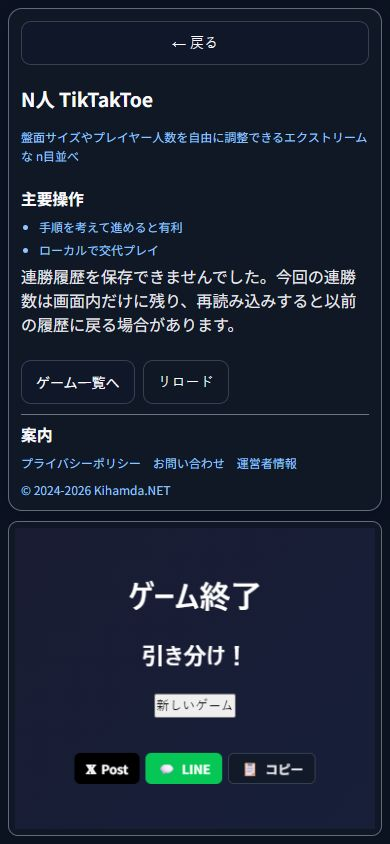
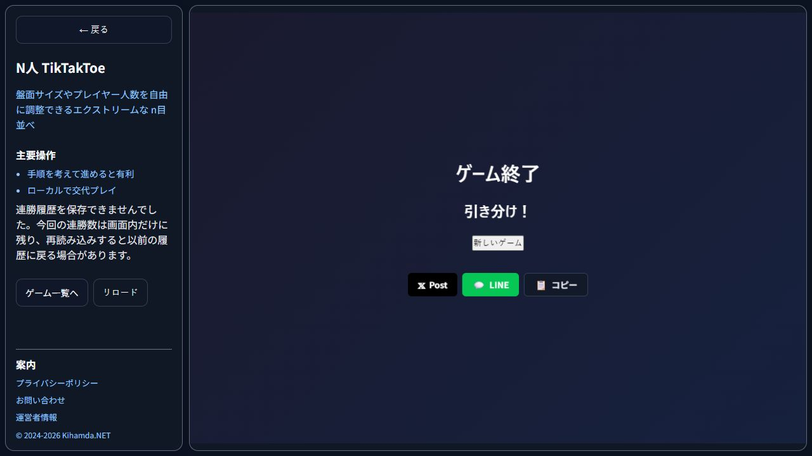

# n目並べの連勝履歴の保存案内

2026-10-15の07時枠。T-web-ntik-streak-storage-noticeで、旧コードが負の連勝数-8を受理し、書き込み拒否をundefined、読み込み拒否を0として通知しないことを実コードから再現した。

連勝数は非負の安全な整数、参加者設定の識別子は文字列として検査する。読み込み拒否と不正形式を区別して表示し、不正な保存は読み込みだけでは削除しない。新しい勝利・引き分けで履歴を更新する。進行・設定・削除と別の通知を持ち、進行の保存成功で連勝の警告を消さない。正常履歴は再読み込み後も復元する。旧count/configHash形式を保持し、連勝の集計方法自体は変更しない。

実Appの回帰で連勝キーだけの読み書き拒否、進行保存成功後の警告保持、勝利と引き分けの保存拒否・回復、再読み込み、形式不正8件、設定不一致、進行だけの削除を検査した。型・ESLint・Vite・5画面生成、35成果物ハッシュ、旧4ルート、検索導線、作品案内8ケースが成功。

専用Chromeの127.0.0.1:4216で通常クリックを使った。例外は連勝キーだけにStorage APIへ注入し、ゲーム盤面は注入しない。390で読み込み拒否後に着手と進行保存が続き、警告が残ることを確認。通常5着手の勝利で保存拒否を表示し、進行after・winner=Player 1は保存された。API復旧後の通常勝利では不正JSONをcount=1へ更新し、警告が消えた。再読み込み後に正常履歴と結果を保持した。

最終ビルドの1280で進行削除後の設定と連勝count=1のJSONが削除前と一致。通常9着手の引き分けで連勝更新を拒否すると、進行after・winner=nullは保存され、旧count=1と警告が残った。390でAPI復旧後に通常9着手するとcount=0へ更新して警告が消えた。390の警告は348×72px/16px、1280は246×96px/16px。横はみ出しなし。最終版の新規開始で読み込み警告も再確認した。

最初の画像は開始案内の一文追加前。その後の最終ビルドで書き込み警告2枚と読み込み警告1枚を撮り直した。再読み込み直後の読み込み例外注入は初期読込後に入って警告が出なかったため証拠に採用せず、新規開始で再現して画像を置き換えた。ブラウザ内容だけを保存した。Storage APIは元へ戻し、viewport解除・専用タブ終了を確認した。実タッチ、Safari、全ブラウザ終了後の復元、人間評価は未確認。指標とreleaseはnull。

本日PR23はすでにマージ済みなので、追加PR・push・配信はせず日次ブランチへローカル保存する。現行CI承認版は変更しない。次の独立工程候補はGravityBallの最高スコア保存再試行。現行useHighScoreは失敗した値をbestRefへ先に反映するため、復旧後の同点更新では保存を再試行しない。これはコード上の候補で、未修正・未検証。

